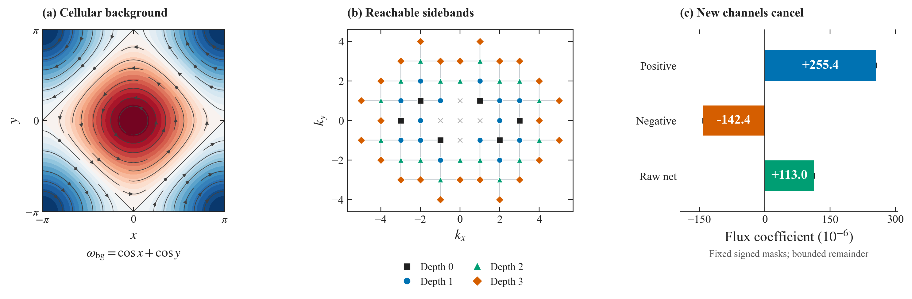
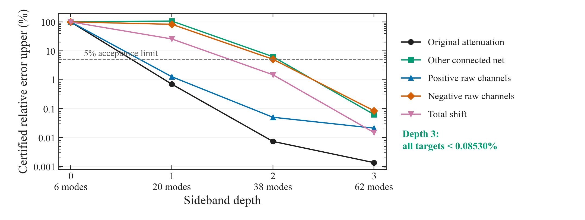

# Phase08：相干涡、三元相位与跨尺度通量

[English](README.md) · [3 页英文 PDF](discovery-note.pdf) · [数学说明](docs/mathematics.md) · [精确证书](evidence/README.md)

## 1. 执行摘要与核心结论

**相干大涡能够通过重组三元相关，显著改变小尺度间的能量传递。** Phase08 在受控二维 Navier–Stokes 波动模型中，将这一物理判断推进为解析证明与精确算术共同支持的定量结果：强度为 $O(1)$（$A=1$）的胞状背景，使负向三波动腿通量首项的幅度减弱约 **10.77%**，认证误差半径小于 $4.78\times10^{-9}$。

位移中**超过 99.43% 来自连通三阶相关**，诱导均值仅占约 0.56%；原三元组衰减贡献约 75.7%，新通道净贡献约 23.7%。后者包含约 $+255.4\times10^{-6}$ 与 $-142.4\times10^{-6}$ 的显著抵消。在指定边带层级中，三层、62 模模型才同时通过全部物理目标，最大认证误差低于 **0.08530%**。这把闭合失效定位到可辨认的反馈与通道缺失。

*解析背景示意、认证模态集合与通道中心值；非 DNS 瞬时场。通道单位为 $10^{-6}$，小于线宽的误差另由证书约束。*

## 2. 母问题与前沿卡点：孤立三元组何时可信？

Waleffe 在 1992/1993 年提出“不稳定性假设”（Instability Assumption）：以孤立三元组的稳定性推断湍流中的平均三阶相关及传输方向。难点在于，真实模态同时参与许多三元组，邻居也会响应目标模态，孤立稳定性为何仍能代表整个网络？[经典工作](https://ntrs.nasa.gov/citations/19920038608)

Benavides–Bustamante 的 2026 年工作保留三元相位自作用，将邻接作用近似为噪声；高斯白噪声近似给出 von Mises 相位分布。其二维预印本明确指出：强相干、能量占优的涡会加强模态相关，破坏弱相关假设及预期相位分布，这一失效有待研究。[壳模型论文](https://arxiv.org/html/2507.03397v2)、[二维预印本](https://arxiv.org/html/2605.03049v1)

**Card A 给出了严格的反馈反例。** 在标准四壳层 Sabra 系数导出的固定幅值随机相位模型中，自作用中性点 $r_*=\sqrt{8/5}$ 处，孤立闭合预测 $\mathbb E\sin\theta=0$；保留双向反馈后，对任意正噪声强度均严格为正。邻近开放区间内，孤立预测甚至为负，使对应能量传输项反号。证明将相位偏置联系到严格为正的 Fisher 信息；换用更复杂但不接受反馈的自主加性噪声，仍不能恢复中性点偏置。这里建立的是指定相位闭合的反号机制，Card B 则将问题推进到有空间涡结构和幅值演化的 PDE。[Card A 证明](docs/mathematics.md)

关键是反馈与自作用的相对大小：接近中性面时，自作用趋零，较小的邻接相关也可能决定符号。因此，“相关性数值不大”本身并不足以保证忽略它安全，必须比较它在传输平衡中的作用。

## 3. 受控分解：相干大涡与波动

在周期环面 $\mathbb T^2$ 上，取被外部维持的背景

$$
\omega=A(\cos x+\cos y)+\epsilon\zeta,
\qquad \widehat\zeta_k=0\quad(|k|\le1).
$$

$A$ 无须很小，$\epsilon$ 控制波动间非线性。波动经历黏性耗散、背景线性输运、自身二次相互作用与加性随机激励。取 $G=(-\Delta)^{-1}$、$J(f,g)=f_y g_x-f_x g_y$，$P_K$ 保留 $1<|k|\le K$，研究归一化通量

$$
T_K(\zeta)=\langle GP_K\zeta,J(G\zeta,\zeta)\rangle,
\qquad \mathcal F_{K,N}(\epsilon)=\epsilon\mu_{\epsilon,N}(T_K).
$$

正值表示流出低波数集合，负值表示向其中输入。这一观测量仅含**三条波动腿**，不混入含固定背景腿的二次传输。

分析突破在于控制截断加密后的导数损失：二次非线性进入 $H^{-3/2}$，黏性半群将其平滑回 $L^2$，短时奇性 $t^{-3/4}$ 可积。结合能量矩界与三次 Poisson 归约，得到

$$
|\mathcal F_{K,N}(\epsilon)-\epsilon^2F_{A,K,N}|
\le C\epsilon^4,
\qquad F_{A,K,N}\longrightarrow F_{A,K}.
$$

对固定实数 $A$、$\nu>0$、$\alpha\ge0$、$K$ 和迹类噪声，$C$ 与截断 $N$ 无关。因此结果具有无限维意义：增加高波数模态不会使余项估计失控。平滑估计的物理含义是，黏性在短时间内恢复非线性作用损失的空间正则性，累积影响仍然有限。定量证书针对首项 $F$；有限 $\epsilon$ 的近似精度仍需计入上述余项。[截断一致证明](docs/mathematics.md)

## 4. 引入大涡：通量偏移与连通相关解剖

固定 $\nu=1,\alpha=0,K=2$，在 $\pm p,\pm q$ 施加随机激励，$p=(3,0)$、$q=(-2,1)$，噪声协方差权重分别为 9、5。它们通过 $p+q=(1,1)$ 向低模输能。无背景时精确有 $F_{0,2}=-1/225$；$A=1$ 时认证为

$$
\begin{aligned}
F_{1,2}&\in[-0.003965854562651,-0.003965845004717],\\
\Delta F_1&\in[0.000478589881793,0.000478599439728].
\end{aligned}
$$

故 $F_{1,2}<0$、$\Delta F_1>0$，负向传输幅度减弱约 10.7684%。这是该通量首项的衰减，未发生方向翻转。无限格残差认证包含未保留模态与源项误差，并分开控制求解、尾项及舍入；数值收敛本身不承担证明。[符号证书](docs/mathematics.md)

计算从线性参考态的协方差出发，求解确定的矩响应方程；精确有理数残差约束候选解与真实响应之差，独立实现交叉复核。因而上述符号来自包含误差的严格区间，而非有限采样平均值或视觉上的平台收敛。

B-M01 进一步将原始三阶响应分解为

$$
\kappa_{3,A}=m_{3,A}-\operatorname{Sym}(m_{1,A}\otimes U_A),
\quad F_A=\underbrace{t\kappa_{3,A}}_{F_A^{\rm conn}}
+\underbrace{t\operatorname{Sym}(m_{1,A}\otimes U_A)}_{F_A^{\rm mean}}.
$$

这里 $U_A$ 是线性 Gaussian 参考态协方差，$m_{1,A},m_{3,A}$ 是非线性一阶响应，$\operatorname{Sym}$ 为三种放置的和；$\kappa_3$ 表示连通三阶累积量的响应。小 $A$ 下，均值项从 $A^4$ 才开始，$A^2$ 修正全部来自连通部分。到 $A=1$，原通道连通衰减、其他连通通道与均值分别约为 $(362.477,113.419,2.699)\times10^{-6}$。均值占比严格落在 **0.563853%–0.563872%**，排除了“主要由诱导均值造成”的解释；主效应是非高斯连通相关的改变。[机制分解](docs/mathematics.md)

这一区分具有直接物理意义：连通项保留无法拆成“均值乘二阶协方差”的三模态联合响应，同时包含幅值与相位的耦合，不能简化成无幅值权重的相位相关系数。

## 5. 三层傅里叶边带如何恢复有符号平衡？

胞状背景的 Fourier 波数是单位向量，因而背景算子通过非零耦合 $k\to k\pm e_x,k\pm e_y$ 混合模态。反复作用生成傅里叶边带（Sidebands），同时改变协方差、三阶响应和可参与传输的三元组。这些层是**耦合图距离**，并非同心波数壳。

B-R01 从原三元组及其共轭六模出发，逐层加入背景邻居；每层保持原方程系数、强迫与观测量，不拟合通量。

| 层级／有符号模态数 | 认证结果及物理含义                        |
| --------- | -------------------------------- |
| 0 层／6     | 背景输运投影为零，预测 $\Delta F=0$，完全漏掉调制。 |
| 1 层／20    | 原通道衰减误差低于 0.71%，但负通道误差超过 82.73%。 |
| 2 层／38    | 负通道误差仍超过 5.1264%，严格不满足 5% 要求。    |
| 3 层／62    | 五项目标全部通过，最大相对误差低于 0.08530%。      |

五项目标为原连通衰减、其余连通净值、正／负原始通道组及总位移。正负组按 B-M01 候选符号固定，未分类尾部另有误差界；其约 $+255.4$ 与 $-142.4$ 的抵消留下 $113.0$，再扣除其他通道的均值项，得到 $113.4$ 的连通净值，单位均为 $10^{-6}$。这解释了为何原通道已很准确，整体平衡仍可失真。

**62 模是该预声明嵌套家族的最小通过者**，不是任意模型的普适最低维数。它说明相干涡可充当多频混合器，单一局部涡黏性不足以表达这里的通道结构；过早截断相互作用邻域，会破坏正负补偿。它不等同于否定所有 LES 闭合。[边带模型证书](docs/mathematics.md)

*图示严格相对误差上界；前三级的淘汰另由误差下界证明。62 模最小性仅指该指定家族。*

## 6. 对流场重构与 LES 的启示及后续桥接

能谱 $E(k)$ 约束二阶幅值统计；三阶传输还取决于幅值加权的相位组织。因此，谱吻合不能保证通量、回传（Backscatter）或间歇事件正确。Phase08 提供了一个具体检验方向：除总通量外，同时检查连通贡献与正负通道平衡，避免让抵消后的单一净值掩盖结构错误。

还须区分两种“相位正确”：内部三元相位 $\phi_p+\phi_q-\phi_{p+q}$ 在整体平移下不变，描述模态间组织；与 DNS 的空间配对相位则决定涡和剪切层是否出现在正确位置。重构可以通过其中一项而未通过另一项，两者应分别评价。

通向实际数据的桥接方式，是对二维三分量（2D–3C）DNS 切片及重构输出做**零重训离线诊断**：用共同面内滤波定义 $\tau_{i\alpha}^\ell=\overline{u_i u_\alpha}^{\ell}-\bar u_i^\ell\bar u_\alpha^\ell$，计算

$$
\Pi_\ell^\parallel=-\sum_{i=1}^{3}\sum_{\alpha=x,y}
\tau_{i\alpha}^\ell\partial_\alpha\bar u_i^\ell,
$$

并按共同粗分辨率 LR 应变／涡量背景条件化，比较正负传递、内部三元组织及 DNS 空间配对。切片缺少法向导数，$\Pi_\ell^\parallel$ 只代表面内传递贡献；二维证明提供待检验的机制，不预设三维切片已满足相同定理。

[图件来源与重建](docs/figures.md) · [验证范围及运行方法](evidence/README.md)
